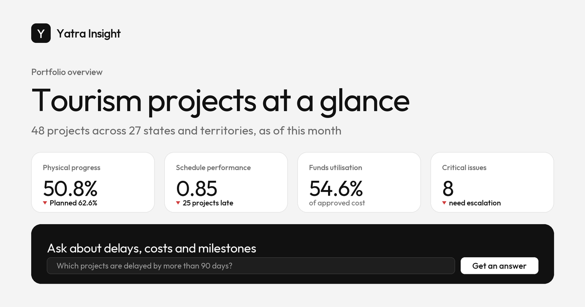

<p align="center"></p>

<h1 align="center">Yatra Insight</h1>

<p align="center"><strong>Ask your tourism projects anything.</strong><br>
An LLM-powered monitoring and decision-support layer for tourism infrastructure and development projects.</p>

<p align="center">Node 24 · React 19 · SQLite (built in) · Groq API · no database server, no UI libraries</p>

---

Officials monitoring projects under schemes such as Swadesh Darshan 2.0, PRASHAD, Challenge Based Destination Development and SASCI often struggle to track progress, read large volumes of data, and spot delays and cost overruns in time. Yatra Insight sits on top of the Project Monitoring System and turns its data into answers and actions.

## Features

| | |
|---|---|
| **Natural-language questions** | *"Which pilgrimage projects in UP are behind schedule?"*, *"What should we do about Konark?"*. Answers stream in with the evidence tables (CSV export) and charts alongside. |
| **Delays, overruns and risks, automatically** | Every project gets a forecast finish date and final cost (earned schedule and earned value), a health status, flags, and a 0–100 risk score with each factor explained. |
| **Corrective measures** | Specific actions, each with an owner and a priority, tied to the flag or open issue behind it. |
| **Progress reports** | Portfolio, filtered or single-project reports, with a narrative written by the AI model. They print cleanly to PDF and download as Markdown. |
| **Add projects** | **Add a project** on the Projects page: a validated form generates the project code (scheme, state, serial) and the six standard milestones from the planned dates. |
| **Milestones and monthly updates** | Milestone timelines and early-warning alerts. Recording a monthly report (with validation) recalculates everything. |
| **Works without an API key** | An offline analysis engine answers common questions from the same data, and the app falls back to it if Groq is unavailable. |

> **Demo data.** The app seeds 48 synthetic projects across 27 states and union territories. The destinations are real places, but the projects, costs, people and issues are invented.

## Quick start

Requires **Node.js 24 or later** (it uses the built-in `node:sqlite` and runs TypeScript natively). There is no database server to install.

```bash
npm install
npm run dev
```

Open http://localhost:5173. The API runs on port 8787 and creates and seeds `data/yatra.db` on first run.

### Turn on the AI model (Groq)

Without an API key the app runs in **offline analysis mode**: a transparent rule-based engine answers common questions from the same data. For open-ended questions and written report narratives, add a key:

```bash
cp .env.example .env   # then set GROQ_API_KEY=gsk_...
```

Restart `npm run dev`. The sidebar shows **Groq connected**. Get a free key at [console.groq.com/keys](https://console.groq.com/keys).

| Variable | Default | Purpose |
|---|---|---|
| `GROQ_API_KEY` | — | Enables the AI model |
| `GROQ_MODEL` | `openai/gpt-oss-120b` | Any Groq chat model with tool calling, e.g. `llama-3.3-70b-versatile` or `openai/gpt-oss-20b` (faster, cheaper) |
| `GROQ_REASONING_EFFORT` | `medium` | `low` / `medium` / `high`; used only by reasoning models (gpt-oss, Qwen 3) |
| `PORT` | `8787` | Port for `npm start` |
| `AS_OF_DATE` | today | Pin "today" for repeatable demos |

### Production

```bash
SITE_URL=https://your-domain npm run build && npm start   # serves the API and the built UI on :8787
```

`SITE_URL` makes the Open Graph and canonical URLs absolute, so shared links preview correctly. It defaults to `http://localhost:8787`.

### Other commands

```bash
npm test          # 30 tests: analytics, SQL guard, validation, offline engine, API, agent loop
npm run typecheck
npm run seed      # wipe and regenerate the demo portfolio
```

## Deploy

Yatra Insight is a single Node process: the API serves the built UI. The SQLite database lives in `data/`, which **must be on persistent storage**; otherwise the demo data is re-seeded and your edits are lost on every redeploy. That rules out purely static or serverless hosts (Vercel, Netlify, GitHub Pages). Use any host that runs a long-lived container with a disk.

### Option A: Render (simplest)

1. Push this repo to GitHub, then on [render.com](https://render.com) choose **New → Web Service** and pick the repo.
2. **Runtime:** Docker (it uses the included `Dockerfile`).
3. **Disk:** add a persistent disk mounted at `/app/data` (1 GB is plenty).
4. **Environment:**
   - `GROQ_API_KEY`: optional; without it the app runs in offline mode.
   - `SITE_URL`: your public URL, e.g. `https://yatra-insight.onrender.com` (it makes link previews work). Render passes environment variables to the Docker build, where the Dockerfile's `ARG SITE_URL` picks it up.
5. Deploy. The service listens on port `8787`; Render detects it.

### Option B: Railway or Fly.io

Both build the same `Dockerfile`. Attach a volume at `/app/data`, set the same environment variables, and expose port `8787`.

```bash
# Fly.io
fly launch --no-deploy            # accept the Dockerfile, choose a region (e.g. bom for Mumbai)
fly volumes create data --size 1
# then in fly.toml add:  [mounts]  source = "data"  destination = "/app/data"
fly secrets set GROQ_API_KEY=gsk_...
fly deploy --build-arg SITE_URL=https://<app>.fly.dev
```

### Option C: Any server with Docker

```bash
docker build -t yatra-insight --build-arg SITE_URL=https://your-domain .
docker run -d --name yatra -p 8787:8787 -v yatra-data:/app/data \
  -e GROQ_API_KEY=gsk_... yatra-insight
```

Put it behind a reverse proxy (nginx or Caddy) for HTTPS. Turn off proxy buffering for `/api/conversations/*/messages` so streamed answers arrive live (`proxy_buffering off;` in nginx).

### Option D: Without Docker

```bash
npm ci && SITE_URL=https://your-domain npm run build
PORT=8787 npm start               # keep it running with pm2 or systemd
```

Needs Node.js 24 or later on the server.

### Before going live

- The demo has **no login**. Put it behind your organisation's SSO or an authenticating proxy before using real data.
- Add real projects with **Add a project** (or `POST /api/projects`), or replace `server/seed.ts` with an import from your Project Monitoring System. All analytics recalculate from the `projects`, `milestones`, `progress_reports` and `issues` tables.

## How the numbers are computed

All analytics live in [`server/analytics.ts`](server/analytics.ts). They are pure functions, unit-tested.

| Measure | Method |
|---|---|
| Planned progress | S-curve `3t² − 2t³` over the planned duration |
| Schedule performance (SPI) | **Earned schedule**: the date the plan reached today's actual progress ÷ time elapsed. Unlike %-based SPI, it doesn't drift back to 1.0 as late projects finish. |
| Forecast finish | start + planned duration ÷ SPI. Stalled projects are forecast as if work resumed today at the planned pace. |
| Cost performance (CPI) | Value of work done ÷ actual spend. Treated as unreliable below 10% progress, because mobilisation advances distort it. |
| Estimate at completion | Approved cost ÷ CPI |
| Risk score (0–100) | Explained sum of schedule (30), forecast delay (25), cost (20), open issues (20), overdue milestones (10), stalled work (10), stale reporting (10) |
| Health | Off track, At risk or On track by SPI, delay, overrun and risk thresholds; plus Completed, On hold and Not started |

Corrective measures come from a playbook keyed by flag and issue type: land, clearances, litigation, utility shifting, contractor performance, fund release (utilisation certificates), design change, price escalation, and others.

## Architecture

```
web/            React 19 + Vite. No UI or chart libraries: hand-built SVG charts and a token-based design system (light + dark).
server/
  analytics.ts  EVM / earned-schedule metrics, flags, risk, recommendations, portfolio roll-ups
  repo.ts       SQLite access, validated writes, metrics cache → project_metrics table
  tools.ts      Analysis tools shared by the LLM and the offline engine
  sqlguard.ts   Read-only SQL for the model: read-only connection + single SELECT + row cap
  llm/agent.ts  Groq streaming tool-calling loop (append-only history)
  llm/groq.ts   Groq client, model and reasoning settings, error messages
  llm/offline.ts Rule-based question answering when no key is set (or Groq fails)
  reports.ts    Fixed data sections + narrative (Groq model or template)
  app.ts        Express API, SSE chat streaming
```

**The model never invents numbers.** It answers through five tools (`list_projects`, `get_project`, `portfolio_summary`, `query_database`, `show_chart`). Every table it used is shown to the user, and SQL can be inspected.

## Design system

The UI follows [tasteskill](https://github.com/leonxlnx/taste-skill) (2.5, page kind *software*), on top of the Power Design web rules. Its deal picked:

- **Palette** `white-link-blue`: a grey ground with white cards, near-black ink `#111`, grey `#6b6b6b` for labels only, and one blue accent `#1a4be0` for the main button, links, focus and chart state. Dark mode uses the palette's inverse set. No violet anywhere (a tasteskill rule).
- **Type:** Outfit (headings at weight 400 with tight tracking, text at 400/500) and DM Mono. Labels are 13px in sentence case, nothing is under 13px except chart axes (12px), and KPI figures share one size that never outgrows the page title.
- **Radius** `soft` (8 / 12 / 20), **buttons** `tonal` (one filled primary per view, tinted secondaries), **mark** `initial` (the "Y" on an ink square).

Rules applied:

- **Neutral interface:** status colours appear only as small marks (an icon, dot or thin bar) beside ink text.
- **Header:** opaque, with one hairline (no blur).
- **Motion:** tasteskill's numbers. Buttons step up 1px on hover and press 1px down at 0.985 scale; linked cards lift 2px; links and nav words draw their underline; the page title rises once per visit; nothing moves on scroll.
- **Copy:** headings name things, buttons are a verb and an object. The authored copy passes tasteskill's `copy-lint` with no FAILs or WARNs.

The website-only parts of tasteskill (one section per screen, photo heroes, shader effects, dealt "moments", the browser gate's page-structure checks) don't apply to a dashboard and were left out.

Implementation:

- **Tokens:** written in OKLCH, two tiers, in [`web/src/styles.src.css`](web/src/styles.src.css). `npm run tokens` builds `styles.css`, stamping the one dark block into both dark selectors; `npm run dev` and `npm run build` run it for you.
- **Spacing:** on the 8-point scale.
- **Icons and share image:** `scripts/make_assets.py` regenerates them.

## Edge cases handled

- No API key, an invalid key, rate limits, network failures or a refusal → the answer falls back to the offline engine, with a notice explaining why.
- Model-written SQL runs on a **read-only** SQLite connection. Only a single `SELECT`/`WITH` is allowed (no `PRAGMA`, `ATTACH` or `RECURSIVE`), and results are capped at 200 rows.
- Progress entries are validated: no future months, cumulative figures can't go backwards or exceed later months, a sanity check catches a likely lakh-vs-crore unit mix-up, and re-reporting a month updates it rather than duplicating it. Reaching 100% completes the project and its milestones.
- Projects with no reports, not yet started, late to start, on hold, stalled, completed, or with stale reports each get correct, specific treatment.
- Chat: one in-flight answer per conversation, a stop button, a 2,000-character limit, a 40-question cap per conversation, and interrupted streams that are never half-saved.
- UI: empty, loading and error states on every view; keyboard-operable charts with table views; reduced-motion support; print styles; mobile layouts down to 320px; LLM output sanitised with DOMPurify.
